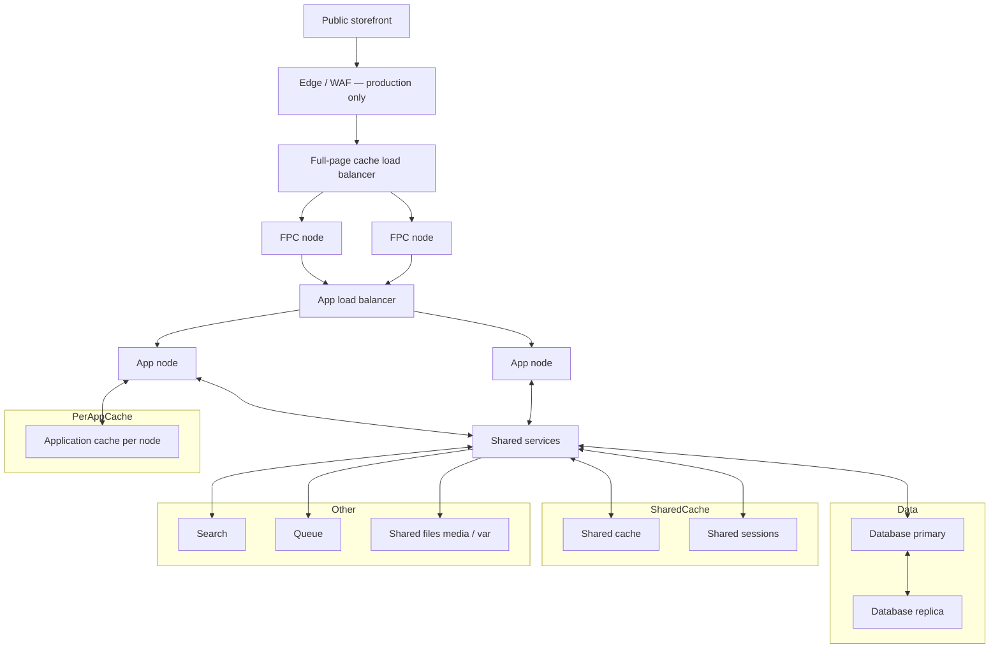

# Infrastructure

Describe the **shape** of environments (edge → cache → app → data), not a host inventory.

## How to fill

1. List which environments exist (production / staging / local is enough). Say only how they **differ** (for example: an edge network only on production; staging has fewer app nodes and no replica).
2. Draw role names in mermaid. **No** public IPs, virtual IPs, local IPs, hostnames that identify a vendor ticket, or panel URLs.
3. Shared vs per-instance cache and sessions — what breaks if the shared cache fills (all apps lose FPC/sessions together vs one node).
4. Where logs and error tracking go. Name the **package** in this repo. No DSN, no project / account id.
5. Shared files (media / generated) if apps are more than one node.
6. Delete the example diagrams after you replace them with this shop’s shape. Do not keep the fictional host labels on a live shop.

Do not paste public IPs, internal IPs, support-desk ticket URLs, cloud account ids, or laptop paths.

## Environment differences (replace)

- **Production:** `REPLACE_ME` — e.g. edge in front of the full-page cache, N cache nodes, N app nodes, primary + replica database.
- **Pre-production / staging:** `REPLACE_ME` — same shape minus edge, or fewer nodes / no replica.
- **Local:** `REPLACE_ME` — single app, no edge. Name the container/tooling family only if this repo documents it.

Observability: `REPLACE_ME` package (PHP/Node + optional browser tag). If a filter package drops known noisy messages, say that in one sentence. Credentials stay in environment config.

## Example shape — production (replace labels, then delete “Example”)

Role-only diagram. Do **not** add addresses.

## Example shape — staging (replace or delete)

Same boxes as production **without** the edge node, or a single FPC + fewer app nodes and a single database. Say which. Do not paste a staging hostname.

## Example shape — local (optional)

One app, one database, cache/session on the same machine. Omit if this repo has no documented local topology.
