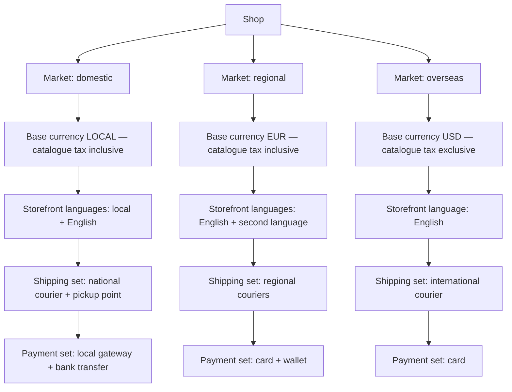

# Markets

How selling regions are split (Magento websites / store views, Shopify markets, currencies, tax display).

Write what **this repo** configures, not a generic platform tutorial.

## How to fill

1. Grep website / market codes in committed config (app config, shop config templates, market metafields) — not a laptop database snapshot.
2. For each market: currency, whether catalogue prices are tax-inclusive, storefront languages, shipping set, payment set.
3. State whether **carts and customer accounts are shared** across markets. Default to write: they are **not**, unless you grep a shared-quote / shared-customer mechanism.
4. Extra margin, price rounding, or net prices for untaxed regions: name the package after you grep it.
5. A market that only changes payment tiles: one sentence here + pointer to [Integrations](./integrations.md). Do not retell the gateway.
6. **No** live website numeric ids, store-view ids, or environment-only market ids in the prose. Codes that are the public contract (and exist in committed config) may be named; ids that exist only in a local database dump are not the contract.

Delete the example diagram after you replace every node. Do not keep `domestic` / `regional` / `overseas` on a live shop.

## Example map (replace)

::: tip Assumptions to confirm from this repo
- Catalogue price lists are per market so rounding and extra margin stay under control. A tax-exclusive market exists only if code/config says so.
- Allowed destination countries and carriers can be scoped per store view / market.
- SEO assumes one storefront language view per language you actually ship.
- Carts and customer accounts are **not** shared across websites / markets unless you grep a link.
- Payment-tile splits are market-scoped in config — point at [Integrations](./integrations.md), do not duplicate the mechanism.
:::
